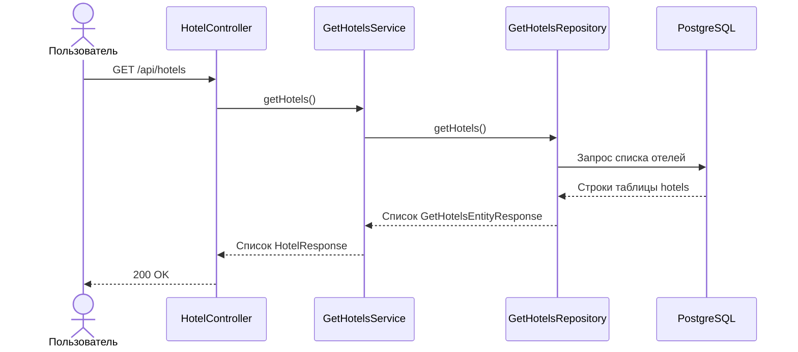

# 🌐 Получение списка отелей

> Возвращает список отелей в порядке возрастания идентификатора. Если отелей нет, возвращает пустой массив.

## ⚙️ Основные характеристики

| Характеристика | Значение |
|----------------|----------|
| URL | `/api/hotels` |
| Метод | `GET` |
| Доступ | JWT с ролью `USER` |
| Код успешного ответа | `200` |

## 📤 Успешный ответ

Тело ответа — JSON-массив. Каждый элемент содержит следующие поля.

| Поле JSON | Тип | Обязательность поля | Описание |
|-----------|-----|---------------------|----------|
| `id` | `number` | ✅ | Идентификатор отеля |
| `name` | `string` | ✅ | Название отеля |
| `address` | `string` | ✅ | Адрес отеля |

```json
[
  {
    "id": 1,
    "name": "<название_отеля>",
    "address": "<адрес_отеля>"
  }
]
```

## 🔒 Проверка доступа

Запрос передаёт заголовок `Authorization: Bearer <токен>`. Сервис проверяет подпись по открытому ключу, срок действия, `iss=hbs-booking-service` и `aud=hbs-api`. Для запроса требуется `role=USER`.

- `401` — токен отсутствует или не прошёл проверку.
- `403` — действительный токен без роли `USER`.

Путь к открытому ключу RSA в формате PEM задаётся в локальном `config/application.yaml`.

```yaml
spring:
  security:
    oauth2:
      resourceserver:
        jwt:
          public-key-location: "file:<путь_к_открытому_ключу>"
```

## 🔁 Последовательность вызовов



## 🧠 Алгоритм

1. Репозиторий читает отели в порядке `id` через `JdbcClient`. [Запрос к таблице hotels](../../src/main/resources/queries/get_hotels/get_hotels.sql)
2. Сервис преобразует строки результата в `HotelResponse`.
3. Контроллер возвращает список со статусом `200`.
