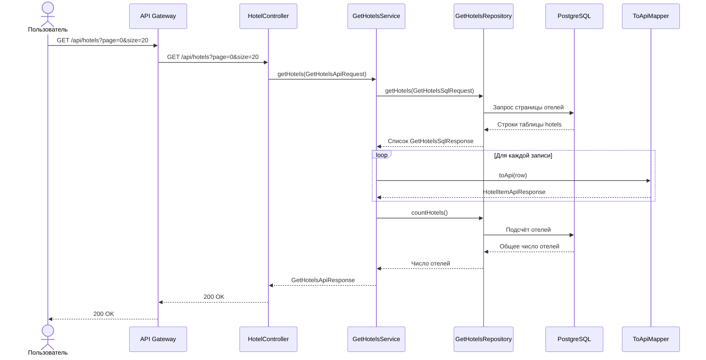

# 🌐 Получение списка отелей

> Возвращает страницу отелей в порядке возрастания идентификатора.

## ⚙️ Основные характеристики

| Характеристика | Значение |
|----------------|----------|
| URL | `/api/hotels` |
| URL через API Gateway | `http://localhost:8080/api/hotels` |
| Метод | `GET` |
| Доступ | JWT с ролью `USER` |
| Код успешного ответа | `200` |

## 📥 Параметры запроса

| Параметр | Тип | Обязательность поля | По умолчанию | Допустимые значения |
|----------|-----|---------------------|--------------|---------------------|
| `page` | `number` | ❌ | `0` | Целое число от `0` |
| `size` | `number` | ❌ | `20` | Целое число от `1` до `100` |

## 📤 Успешный ответ

| Поле JSON | Тип | Обязательность поля | Описание |
|-----------|-----|---------------------|----------|
| `page` | `number` | ✅ | Номер запрошенной страницы |
| `size` | `number` | ✅ | Размер страницы |
| `total_elements` | `number` | ✅ | Общее число отелей |
| `total_pages` | `number` | ✅ | Общее число страниц |
| `hotels` | `array` | ✅ | Отели на запрошенной странице |

При пустой базе `total_pages` равно `0`. Если на запрошенной странице нет отелей, `hotels` содержит пустой массив.

Поля элемента массива `hotels` описаны ниже.

| Поле JSON | Тип | Обязательность поля | Описание |
|-----------|-----|---------------------|----------|
| `id` | `number` | ✅ | Идентификатор отеля |
| `name` | `string` | ✅ | Название отеля |
| `address` | `string` | ✅ | Адрес отеля |

```json
{
  "page": 0,
  "size": 20,
  "total_elements": 1,
  "total_pages": 1,
  "hotels": [
    {
      "id": 1,
      "name": "<название_отеля>",
      "address": "<адрес_отеля>"
    }
  ]
}
```

## 🔒 Проверка доступа

Запрос передаёт заголовок `Authorization: Bearer <токен>`. Сервис проверяет подпись по открытому ключу, срок действия, `iss=hbs-booking-service` и `aud=hbs-api`. Для запроса требуется `role=USER`.

Путь к открытому ключу RSA в формате PEM задаётся в локальном `config/application.yaml`.

```yaml
spring:
  security:
    oauth2:
      resourceserver:
        jwt:
          public-key-location: "file:<путь_к_открытому_ключу>"
```

## 🔁 Последовательность вызовов



## 🧠 Алгоритм

1. Сервис определяет `page` и `size`, затем вычисляет смещение `page * size`.
2. Репозиторий читает страницу в порядке `id`. [Запрос страницы](../../src/main/resources/queries/get_hotels/get_hotels.sql)
3. Маппер преобразует каждую строку в `HotelItemApiResponse`.
4. Репозиторий считает общее число отелей в той же транзакции. Сервис вычисляет общее число страниц. [Подсчёт отелей](../../src/main/resources/queries/get_hotels/count_hotels.sql)
5. Контроллер возвращает страницу отелей со статусом `200`.
